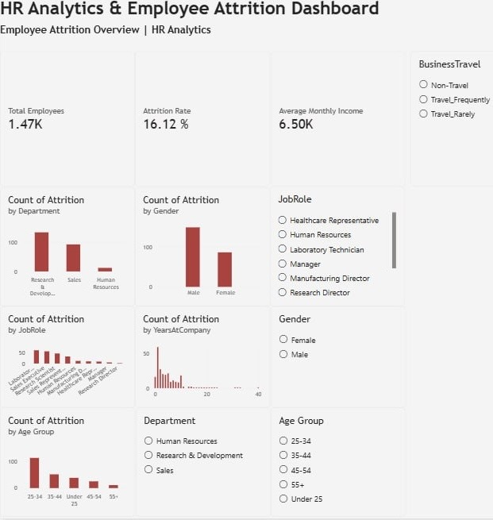

Sales Data Analysis & Business Intelligence Dashboard

Project Overview

An interactive Power BI dashboard designed to analyze sales performance and identify business trends.

Tools Used

* Power BI
* Power Query
* DAX
* Data Visualization

Key Performance Indicators (KPIs)

* Total Sales
* Total Orders
* Total Quantity Sold
* Average Order Value

Analysis

* Monthly sales trends
* Sales by product category
* Sales performance by city
* Top 5 products by sales

Dashboard Features

* Interactive charts
* Slicers and filters
* Sales performance KPIs
* Monthly trend analysis

Key Learnings

This project provided practical experience in analyzing sales data, creating KPIs, and building interactive dashboards to support data-driven decision-making.

Dataset

Sales transaction data covering the year 2025.
## Dashboard Preview

